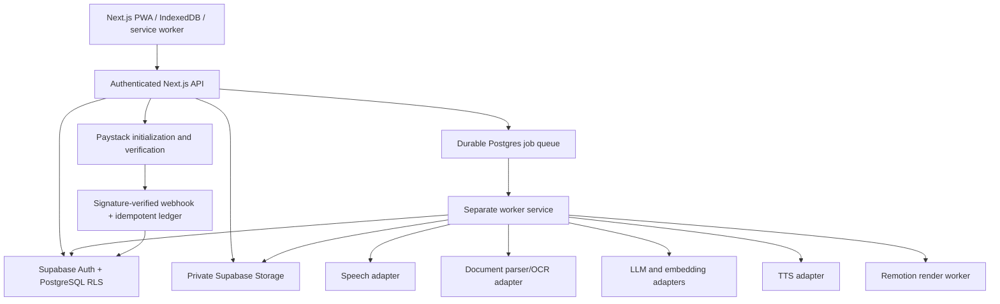

# StudyMate V1.0 architecture and acceptance foundations

## Product information architecture
Five primary phone destinations: Home, Courses, Studio, Practice, More. Secondary routes: Tutor, Planner, Groups, Library, Analytics, Billing, Settings, Admin, Assignments. Course workspace is the context boundary. Every generated artifact must reference `owner_id`, `course_id`, `source_id`, `source_version`, `topic_id` when applicable, and provenance metadata.

## Production architecture

## Critical recording state machine
`local_recording -> local_saved -> upload_pending -> uploaded -> transcribing -> transcript_verified -> generating_notes -> notes_durable_verified -> delete_pending -> deleted`. Failure before `notes_durable_verified` MUST retain the recoverable audio. Deletion runs only after durable read-back validation of transcript and note artifacts, and must be idempotent. Retry deletion independently; account for abandoned upload multipart parts and provider retention separately. Optional explicit retention creates an audited policy exception. Never imply browser recording continues reliably when the phone locks.

## Access and trust boundaries
Authenticate each request server-side. RLS is mandatory on all user tables. Private object paths must not be considered authorization. Generate signed URLs only after checking resource ownership or explicit group grant. Filter pgvector retrieval by authorized source IDs *before* similarity ranking. Never trust uploaded instructions; sanitize parsing outputs. Cite actual page/timestamp spans; abstain when sources lack support. Never treat a Paystack browser redirect as payment confirmation.

## Provider/cost decision matrix (quotes not verified)
| Capability | Candidate | Variable cost driver | Control |
|---|---|---|---|
| STT | Whisper-compatible managed provider | audio minutes | minutes quota + duration cap |
| OCR | managed OCR or self-hosted parser | pages/compute | page quota |
| LLM/RAG | interchangeable hosted model | input/output tokens | token budget + cached embeddings |
| Embeddings | interchangeable embedding model | chunks/tokens | dedupe by source hash |
| TTS | managed voice provider | characters | length and monthly quota |
| Video | Remotion worker + licensed assets | render CPU/memory/storage | credit reservation + concurrency |
| Storage | Supabase private buckets | GB-month + egress | retention + download controls |
| Billing | Paystack | payment transaction fees | reconcile provider webhooks |

No actual unit prices or provider availability have been validated. Configure Free/Plus/Pro limits after measuring per-job costs.

## Security and QA gates
- Verify 320, 360, 390, 430, 768, 1024, 1440 CSS px, Android Chrome, keyboard, TalkBack, axe/WCAG 2.2 AA.
- Verify RLS with user A vs user B, including object downloads, vector search and group revocation.
- Test audio permission denial, page interruption, offline upload recovery, job retry, verified save, deletion retry, abandonment cleanup.
- Test OCR corrupted scans, hallucination abstention, actual RAG citations and source versioning.
- Test spaced repetition and CBT grading, offline cached flashcards, conflicts on reconnection.
- Test video render worker failure and idempotent retry; Paystack invalid signatures, replay, and subscription downgrade.
- Test account export/deletion, provider retention disclosure, abuse reporting, cost limits and quota exhaustion.
- Collect real Core Web Vitals and perform threat modeling before release.

## Deployment and local execution
The prototype is standalone: open `prototype/index.html` in a browser or serve its folder with `python3 -m http.server 8080`. It is not the Next.js production application. Production prerequisites: Supabase project, verified provider accounts, separately deployed worker, private buckets, Paystack keys, domain, and tested webhook endpoint. Never expose service-role or Paystack secret keys to the browser.
